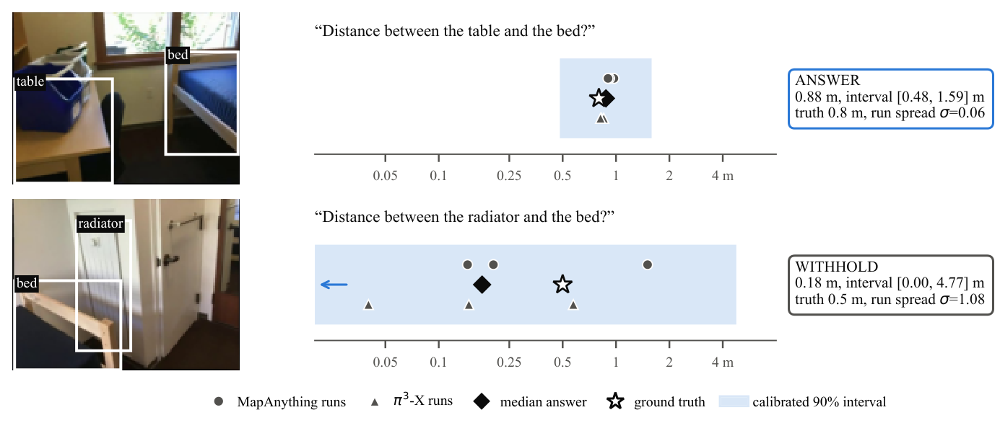
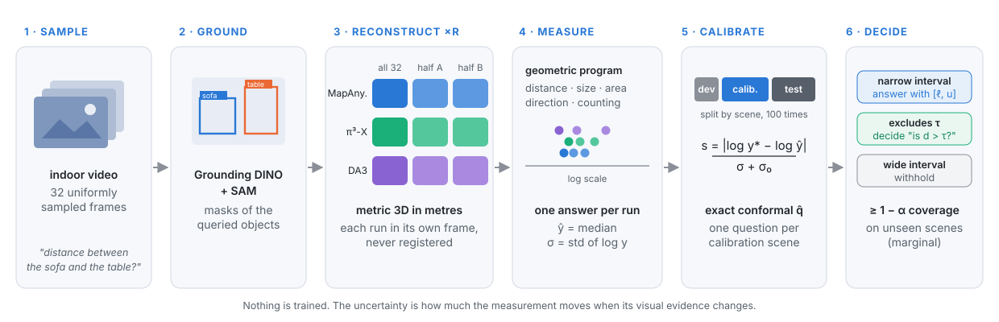
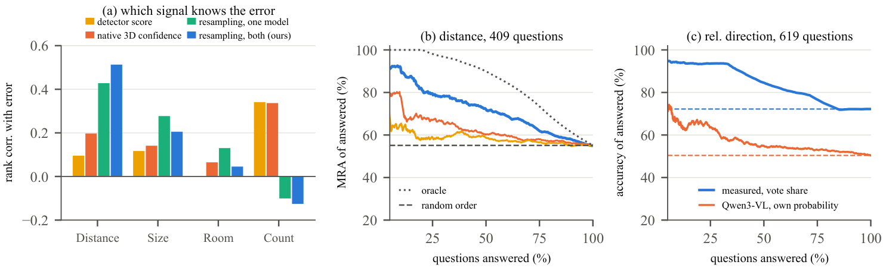
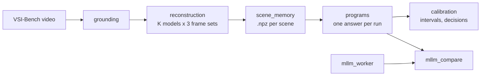

<div align="center">

# Measure Twice
### Calibrated Error Bars for Metric Spatial Questions from Video

**Vaibhav Kanojia**<br>
Delhi Technological University

**NeurIPS 2026 Workshop on Physical World AI** (poster)

[](https://openreview.net/group?id=NeurIPS.cc/2026/Workshop/PhysWorldAI_Poster)
[](https://physworld-org.github.io/physworld.github.io/)
[](LICENSE)
[](pyproject.toml)
[](#reproduce-the-paper-cpu-only)



</div>

> **TL;DR.** For distance questions from video, how much a 3D measurement *moves when its visual evidence changes*
> predicts its error far better than the confidence that 3D foundation models or MLLMs report. Calibrated on held-out
> scenes, this signal gives intervals less than half as wide as uncertainty-blind ones, with a coverage guarantee.

---

## Overview

Spatial benchmarks such as [VSI-Bench](https://github.com/vision-x-nyu/thinking-in-space) ask for physical quantities
from video: distances, object sizes, room areas. Every system answers with a single number. A robot that must decide
whether it fits through a gap needs to know **how far to trust that number**.

Measure Twice builds the error bar by measuring. Open-vocabulary grounding finds the queried objects, metric
reconstructors (MapAnything, π³-X, Depth Anything 3) lift them into metres, and a small geometric program computes the
answer. The measurement is **repeated on random halves of the frames and with other models**. The spread of these
repeats, calibrated with scene-level split conformal prediction, becomes an interval that holds on scenes the system has
never seen. **Nothing is trained.**

<p align="center"></p>

## Highlights

| | |
|---|---|
| **Which signal knows the error?** | On distance questions, resampling spread correlates with the error at **ρ = 0.51**, against **0.20** for the 3D models' native confidence and **0.10** for the detector score. |
| **Tighter calibrated intervals** | At ≈ 90 % coverage on unseen scenes the median distance interval is **2.7 m**, against **6.3 m** without uncertainty. |
| **Views, not models** | Re-running *one* model on other frames ranks errors better than consulting *other* models (ρ 0.43–0.46 vs 0.38 at three reconstructions each). |
| **Safer decisions** | "Is the gap wider than τ?" is settled for **35.7 %** of question–threshold pairs with **5.9 %** error, against **10.6 %** for an equally selective control and **15.8 %** for always answering. |
| **Two kinds of confidence** | On the whole benchmark, Qwen3-VL's confidence cannot rank its distance errors (ranking gain −1.6) while the measured spread can (14.6); for counting the roles flip. |
| **Honest limits** | Shared errors that every view sees (missed instances, unseen room parts, video compression) are invisible to resampling. |

## Results

**Interval quality on unseen scenes** (VSI-Bench, 409 distance questions from 151 scenes with all runs; every row is
calibrated to ≈ 90 % coverage around the *same* median answer; 100 scene-level splits).

| Uncertainty signal | ρ with error ↑ | median width (m) ↓ | AURC ↓ |
|---|:---:|:---:|:---:|
| Constant log-width (no uncertainty) | 0.00 | 6.3 | 0.447 |
| Detector score | 0.10 | 6.0 | 0.418 |
| Native 3D confidence | 0.20 | 6.8 | 0.366 |
| Model disagreement | 0.37 | 5.9 | 0.335 |
| Resampling, MapAnything | 0.43 | 3.0 | 0.317 |
| Resampling, π³-X | 0.43 | 3.4 | 0.314 |
| **Resampling, both (ours)** | **0.51** | **2.7** | **0.276** |

<p align="center"></p>

**Robustness, added for the camera-ready version** (all reproducible with `scripts/robustness.py`):

* **Beyond the complete-output subset.** Recalibrated on all 625 answered distance questions with ≥ 2 runs, coverage is
  89.8 % with a 3.3 m median width (6.3 m without uncertainty); the upper tail is wider (90th percentile 27.2 vs 14.3 m).
* **How wide is wide?** On Table 1's splits the median distance interval spans roughly a factor of 2.0 on either side of
  the answer (4.1 without uncertainty), and 2.0 m on the most certain half. Adaptive intervals are wider than the
  constant ones for the least certain questions (90th percentile 17.3 vs 14.3 m), which selective answering withholds.
* **Own-answer ablation.** When each three-run signal also answers with the median of its own three runs, within-model
  resampling still ranks distance errors better (ρ 0.44–0.47 vs 0.37).

See the paper for object size, room area, counting, cross-dataset transfer, physical degradations and the full MLLM
comparison.

## Installation

```bash
git clone https://github.com/VaibhavKanojia3773/measure-twice.git
cd measure-twice
pip install -e .                    # CPU analysis: numpy, scipy, matplotlib
pip install -e ".[gpu]"             # + GPU pipeline and MLLM baselines (PyTorch, transformers, OpenCV)
```

The three reconstructors are cloned and installed automatically on first use
([`measure_twice/backbones.py`](measure_twice/backbones.py)). Set `HF_TOKEN` if your Hugging Face account needs it.

## Reproduce the paper (CPU only)

All per-run measurements and MLLM outputs behind the paper are in [`results/`](results), so every table can be rebuilt
without a GPU or any video download:

```bash
python scripts/reproduce_paper.py --quick   # Table 1 distance row, a few minutes
python scripts/reproduce_paper.py           # Tables 1-4 and robustness analyses (~30 min)
python scripts/make_figures.py              # figures/evidence.pdf (and the teaser, if frames are available)
```

The calibration code in this repository reproduces the paper's analysis file **bit for bit** from
`results/vsi_answers.json`.

## Run the pipeline on VSI-Bench (GPU)

```bash
# one shard, all three reconstructors, every visible GPU (the paper used 2x NVIDIA T4, 16 GB)
python scripts/run_pipeline.py --shard scannet --models mapanything,pi3x,da3m --limit 2   # smoke test
python scripts/run_pipeline.py --shard scannet --models mapanything,pi3x,da3m
# spatial MLLM baseline with its own confidence
python scripts/run_mllm.py --model Qwen/Qwen3-VL-8B-Instruct --frames 16 --out results/mllm/mine/run.jsonl
```

`MT_WORK` (downloads, checkpoints) and `MT_OUT` (per-scene 3D memory, logs) control where files go.

## Use the calibration on your own measurements

The calibration is independent of the 3D pipeline: any repeated measurement works. Give each question its scene, its
ground truth (for calibration scenes), a point answer and a spread:

```python
import numpy as np
from measure_twice.calibration import conformal, selective

runs = {...}   # question id -> list of repeated measurements (e.g. on different frame subsets)
T = [dict(id=i, scene=scene_of[i], gt=truth[i], point=float(np.median(v)),
          sig={"const": 1.0, "comb": float(np.std(np.log(np.asarray(v) + 1e-2)))})
     for i, v in runs.items() if len(v) >= 2]

res = conformal(T, "object_abs_distance", "comb", alpha=0.1)   # scene-level splits, exact finite-sample quantile
print(res["cov"], res["width"])                                # mean coverage on test scenes, median width
print(selective(T, "object_abs_distance", "comb")["aurc"])     # risk-coverage of selective answering
```

The guarantee is marginal: it covers a randomly drawn eligible question of a new scene from the calibration
distribution, not every question and not a shifted dataset.

## Repository structure

```
measure_twice/
  grounding.py         Grounding DINO + SAM masks of the queried object categories
  backbones.py         install + load MapAnything, pi3-X, Depth Anything 3 (metric)
  reconstruction.py    metric multi-view reconstruction -> world points, native confidence, cameras
  scene_memory.py      per-scene 3D memory: every model on all frames and on two random halves (GPU)
  programs.py          geometric programs: distance, size, room area, direction, counting, order (CPU)
  calibration.py       scene-level split conformal, signals, selective answering, decisions, transfer
  mllm_worker.py       spatial MLLMs on VSI-Bench with their own confidence (GPU)
  mllm_compare.py      MLLM confidence vs. measured spread, and routing between them
  degradations.py      physically based low light, defocus and H.264 degradations
  degradation_eval.py  do the clean error bars survive degraded video?
scripts/               reproduce_paper.py, robustness.py, make_figures.py, run_pipeline.py, run_mllm.py
results/               released per-run answers and MLLM outputs (see results/README.md)
```



## Limitations

The coverage guarantee is marginal and assumes new scenes come from the calibration distribution; it can fail under
dataset shift (room area transfers worst). Resampling cannot see errors that every view shares: instances missed in
every frame, room parts no frame covers, or compression artefacts. The pipeline answers 633 of 834 distance questions;
the rest fail at detection. Intervals are narrower than uncertainty-blind ones, but still too wide for fine clearance
decisions.

## Citation

```bibtex
@inproceedings{kanojia2026measuretwice,
  title     = {Measure Twice: Calibrated Error Bars for Metric Spatial Questions from Video},
  author    = {Kanojia, Vaibhav},
  booktitle = {NeurIPS 2026 Workshop on Physical World AI: Geometry, Characteristics, and Multimodal Sensing},
  year      = {2026}
}
```

## Acknowledgements

This work builds on [VSI-Bench](https://github.com/vision-x-nyu/thinking-in-space),
[MapAnything](https://github.com/facebookresearch/map-anything), [π³](https://github.com/yyfz/Pi3),
[Depth Anything 3](https://github.com/ByteDance-Seed/Depth-Anything-3),
[Grounding DINO](https://github.com/IDEA-Research/GroundingDINO), [SAM](https://github.com/facebookresearch/segment-anything),
[Qwen3-VL](https://github.com/QwenLM/Qwen3-VL) and [VST](https://huggingface.co/rayruiyang/VST-7B-RL). Each keeps its own
license; the released measurements are derived from VSI-Bench questions and annotations.

## License

Code: [MIT](LICENSE). Paper: CC BY 4.0.
